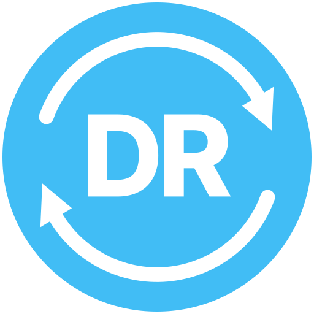

# DigitalPlat Renew HA



*Caducidad y renovación de tus dominios gratuitos de DigitalPlat desde Home Assistant.*

[](https://hacs.xyz/)
[](https://github.com/barnynv/digitalplat-renew-ha/releases)
[](https://github.com/barnynv/digitalplat-renew-ha/actions/workflows/validate.yml)
[](https://github.com/barnynv/digitalplat-renew-ha/blob/main/LICENSE)

Vigila la caducidad de tus dominios gratuitos de [DigitalPlat](https://domain.digitalplat.org)
(`.dpdns.org`, `.qzz.io`, `.us.kg`…) y renuévalos desde Home Assistant con un botón que
**solo se activa cuando se abre el plazo de renovación gratuita**, igual que el de la web.

> Proyecto de la comunidad, sin relación oficial con DigitalPlat.

[](https://my.home-assistant.io/redirect/hacs_repository/?owner=barnynv&repository=digitalplat-renew-ha&category=integration)

---

## Índice
- [Qué añade](#qué-añade)
- [Requisitos](#requisitos)
- [Instalación](#instalación)
- [Configuración](#configuración)
- [Uso](#uso)
- [Ejemplos](#ejemplos)
- [Solución de problemas](#solución-de-problemas)
- [Limitaciones conocidas](#limitaciones-conocidas)
- [Privacidad y seguridad](#privacidad-y-seguridad)
- [English](#english)

## Qué añade

Cada dominio seleccionado aparece como un dispositivo con estas entidades:

| Entidad | Tipo | Descripción |
|---|---|---|
| Fecha de expiración | Sensor (fecha) | `expires_at` según DigitalPlat |
| Días restantes | Sensor | Días hasta la caducidad |
| Apertura de renovación | Sensor (fecha) | Día en que se abre la renovación gratuita |
| Estado | Sensor | Estado del dominio en DigitalPlat (`ok`, …) |
| Renovación disponible | Sensor binario | `on` dentro del plazo de renovación gratuita |
| **Renovar** | Botón | Renueva el dominio. **No disponible** fuera del plazo |

Al pulsar **Renovar**, la integración:
1. Vuelve a consultar DigitalPlat para confirmar que el plazo está abierto.
2. Envía **una sola** petición de renovación (con `Idempotency-Key` para evitar duplicados).
3. Lee de nuevo la fecha y muestra una notificación con el resultado.
4. Nunca reintenta una renovación por su cuenta.

## Requisitos
- Home Assistant **2024.12** o posterior. El icono de la integración se ve desde **2026.3**.
- Una cuenta de DigitalPlat con al menos un dominio y una **clave API**.

## Instalación

### Con HACS (recomendado)
1. Pulsa el botón **Abrir en HACS** de arriba, o bien:
   HACS → ⋮ → **Repositorios personalizados** → URL `https://github.com/barnynv/digitalplat-renew-ha` → tipo **Integración**.
2. Busca **DigitalPlat Renew HA** → **Descargar**.
3. Reinicia Home Assistant.

### Manual (Samba, File editor…)
1. Descarga la última [release](https://github.com/barnynv/digitalplat-renew-ha/releases).
2. Copia la carpeta `custom_components/digitalplat` en `/config/custom_components/`.
   Debe quedar `/config/custom_components/digitalplat/manifest.json`.
3. Reinicia Home Assistant (reinicio completo).

## Configuración

1. En DigitalPlat, abre **[API Keys](https://dashboard.digitalplat.org/dashboard/api/keys)** y crea una clave.
   Empieza por `dp_live_` y **solo se muestra una vez**.
2. En Home Assistant: **Ajustes → Dispositivos y servicios → Añadir integración → DigitalPlat Renew HA**.
3. **Paso 1 – Clave API:** pégala. Se valida en el momento.
4. **Paso 2 – Dominios:** marca los que quieres vigilar (aparecen con su fecha de caducidad) y ajusta:

| Opción | Por defecto | Descripción |
|---|---|---|
| Plazo de renovación gratuita | 120 días | Días antes de la caducidad en que DigitalPlat permite renovar gratis |
| Frecuencia de actualización | 6 horas | Cada cuánto se consulta DigitalPlat |

Puedes añadir **varias cuentas**: repite el proceso con otra clave.

### Cambiar ajustes después
En **Ajustes → Dispositivos y servicios → DigitalPlat Renew HA**:
- **Configurar:** añadir o quitar dominios, cambiar el plazo o la frecuencia.
- **⋮ → Reconfigurar:** sustituir la clave API (debe ser de la misma cuenta).
- Si la clave se revoca, Home Assistant mostrará un aviso para introducir una nueva.

## Uso
- Añade la tarjeta de ejemplo a tu panel para ver fechas y el botón.
- Crea la automatización de ejemplo para recibir un aviso en el móvil cuando se abra el plazo.
- Cuando llegue el aviso, pulsa **Renovar** en Home Assistant.

## Ejemplos
- [`examples/dashboard_card.yaml`](examples/dashboard_card.yaml): tarjeta con datos y botón con confirmación.
- [`examples/automation_notify.yaml`](examples/automation_notify.yaml): aviso al móvil cuando se abre el plazo.

Los `entity_id` dependen del nombre del dominio y del idioma de tu instalación.
Consúltalos en **Ajustes → Dispositivos → (tu dominio)**.

## Solución de problemas

| Síntoma | Solución |
|---|---|
| No aparece en *Añadir integración* | Comprueba la ruta `/config/custom_components/digitalplat/manifest.json`, reinicia por completo y recarga el navegador (Ctrl+F5) |
| "La clave debe empezar por dp_live_" | Copia la clave entera desde DigitalPlat, sin espacios |
| "Clave API no válida o revocada" | Crea una clave nueva en DigitalPlat → API Keys |
| "Esta cuenta no tiene dominios" | La clave es de otra cuenta, o la cuenta no tiene dominios |
| El botón Renovar está en gris | Es lo normal fuera del plazo de renovación gratuita |
| La renovación falla | La notificación muestra el mensaje de DigitalPlat; renueva desde la web y abre un issue con ese mensaje |
| No se ve el icono | Necesitas Home Assistant 2026.3 o posterior |

Para ver más detalle, añade a `configuration.yaml` y reinicia:
```yaml
logger:
  default: warning
  logs:
    custom_components.digitalplat: debug
```
También puedes descargar el diagnóstico (⋮ → **Descargar diagnóstico**); la clave sale oculta.

## Limitaciones conocidas
- En la documentación de DigitalPlat, `POST /api/v1/domains/{dominio}/renew` aparece en la sección
  "Dominios registrados". No está confirmado que cubra la renovación gratuita de todos los sufijos.
  Si falla, abre un issue con el mensaje de error (sin la clave).
- El plazo gratuito lo marca DigitalPlat y puede cambiar: ajústalo en las opciones.
- Renovar fuera del plazo gasta créditos; por eso el botón está bloqueado.

## Privacidad y seguridad
- La clave se guarda solo en tu Home Assistant y solo se envía a `domain-api.digitalplat.org`.
- El diagnóstico descargable oculta la clave.
- Usa una clave dedicada para Home Assistant y revócala si dejas de usar la integración.
- No compartas nunca tu clave en issues ni capturas.

## Contribuir
Consulta [CONTRIBUTING.md](CONTRIBUTING.md). Historial de cambios en [CHANGELOG.md](CHANGELOG.md).
Para publicar tu propio fork: [docs/PUBLICAR_EN_GITHUB.md](docs/PUBLICAR_EN_GITHUB.md).

---

## English

Tracks the expiration of your DigitalPlat free domains and adds a **Renew** button that is only
enabled inside the free renewal window, just like the one on the website.

**Install:** HACS → ⋮ → *Custom repositories* → `https://github.com/barnynv/digitalplat-renew-ha`,
type *Integration* → download → restart. Or copy `custom_components/digitalplat` to
`/config/custom_components/` and restart.

**Configure:** create an API key at *DigitalPlat → API Keys*, then *Settings → Devices & services →
Add integration → DigitalPlat Renew HA*, paste the key and pick the domains to track. Options let you
change tracked domains, the free renewal window (default 120 days) and the polling interval.

Each domain gets: expiration date, days left, renewal opens, status, renewal available, and a
**Renew** button. Requires Home Assistant 2024.12+ (integration icon visible from 2026.3).

Community project, not affiliated with DigitalPlat.

## Licencia
[MIT](https://github.com/barnynv/digitalplat-renew-ha/blob/main/LICENSE)
